# On the applications of commutator contours
*by Hrvoje Abraham, ahrvoje@gmail.com, 01.07.2024.*

I accidentally noticed that some contours with special properties, commutator contours, appear as a solution of two rather distinct problems: picture-hanging puzzles and integral representations of special functions. In this post we will unify these two stories.

## Commutator contours
Camille Jordan was first to introduce the concept of commutator contour in his legendary Cours d'Analyse [[1]](#1) in 1887, which to regret of many was never translated into English. As he introduced it first I will call it Jordan-Pochhammer contour, not only Pochhammer contour as most often referenced by formal sources. As described in the Wikipedia article on Jordan-Pochhammer contour [[2]](#2):

> *A Pochhammer contour winds clockwise around one point, then clockwise around another point, then counterclockwise around the first point, then counterclockwise around the second. ... Its winding number about any point is 0 despite the fact that within the doubly punctured plane it cannot be shrunk to a single point.*

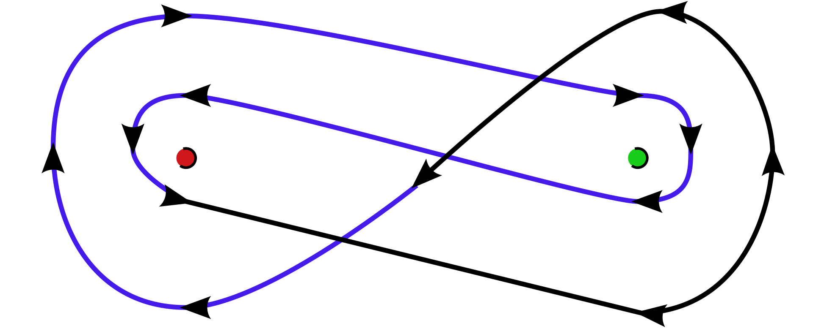

Net zero winding can be easily checked by illustration of the contour cycle:

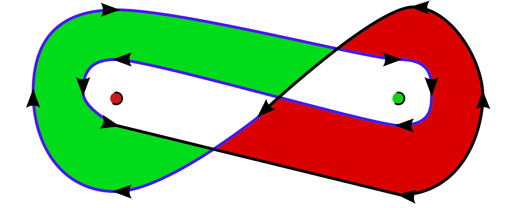

Jordan-Pochhammer contour is an example of commutator contour for two points. The question is can such contour be constructed given n points, and how? The answer is positive, and the paper [[3]](#3) on picture-hanging puzzles offers two constructions, exponential and polynomial.

We define $2n$ symbols ($x_1$, $x_1^{-1}$, ..., $x_n$, $x_n^{-1}$) with $x_n$ being winding the curve around point $1$ clockwise and $x_n^{-1}$ for winding counterclockwise.

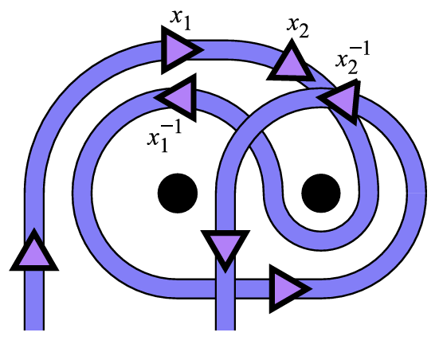

In exponential construction 3-point commutator curve can be built starting with 2-point version and than simply checking the 3-point commutator:

$$S_2 = [x_1, x_2] = x_1 x_2 x_1^{-1} x_2^{-1}$$

$$
\begin{equation*}
\begin{split}
S_3 &= [S_2, x_3] = S_2 x_3 S_2^{-1} x_3^{-1} = \\
    &= (x_1 x_2 x_1^{-1} x_2^{-1}) x_3 (x_1 x_2 x_1^{-1} x_2^{-1})^{-1} x_3^{-1} = \\
    &= x_1 x_2 x_1^{-1} x_2^{-1} x_3 x_2 x_1 x_2^{-1} x_1^{-1} x_3^{-1}
\end{split}
\end{equation*}
$$

This construction is called exponential as the size of the commutator for one additional point is bigger by factor 2, with additional two entries for $x_n$ and $x_n^{-1}$, as with every step we get $S_n = [S_{n-1}, x_n] = S_{n-1} x_n S_{n-1}^{-1} x_n^{-1}.$

It is more convenient to use more efficient version if possible, and that one is the polynomial construction designed by Chris Lusby Taylor [[3]](#3), [[4]](#4). For a single point we define $E(i:i)=x_i$, for two points we define $E(i:i+1) = [x_i, x_{i+1}] = x_i x_{i+1} x_i^{-1} x_{i+1}^{-1}$. Now for some specific problem with n points the solution is obtained by recursion

$$E(i:j) = \left[ E(i:\lfloor \frac{i+j}{2} \rfloor), E(\lfloor \frac{i+j}{2} \rfloor + 1 : j) \right].$$

Using polynomial construction for 3 points doesn't result in any gain compared to the exponential version, but for 4 points polynomial commutator contains 16 symbols compared to 22 for exponential version.

$$
\begin{equation*}
\begin{split}
E(1:4) &= [E(1:2), E(3,4)] = E(1:2) E(3,4) E(3,4)^{-1} E(1:2)^{-1} = \\
       &= (x_1 x_2 x_1^{-1} x_2^{-1}) (x_3 x_4 x_3^{-1} x_4^{-1}) (x_1 x_2 x_1^{-1} x_2^{-1})^{-1} (x_3 x_4 x_3^{-1} x_4^{-1})^{-1} = \\
       &= x_1 x_2 x_1^{-1} x_2^{-1} x_3 x_4 x_3^{-1} x_4^{-1} x_2 x_1 x_2^{-1} x_1^{-1} x_4 x_3 x_4^{-1} x_3^{-1}
\end{split}
\end{equation*}
$$

Length of n-point commutator resulting from polynomial construction is $n^2$ (hence the name) which is of considerable difference compared to exponential version with size $2^n$.

## Picture-hanging puzzles
As mentioned, corresponding commutator contour is the solution of the Picture-hanging problem stating: "Hang a picture on n nails so that removing any one nail fells the picture."

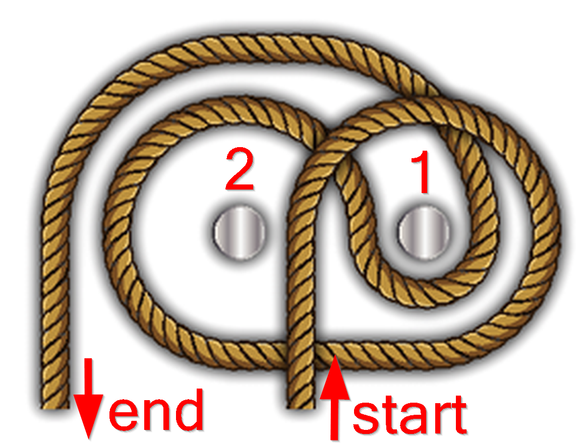

*Picture-hanging solution for two nails problem with the commutator $x_1 x_2 x_1^{-1} x_2^{-1}$*

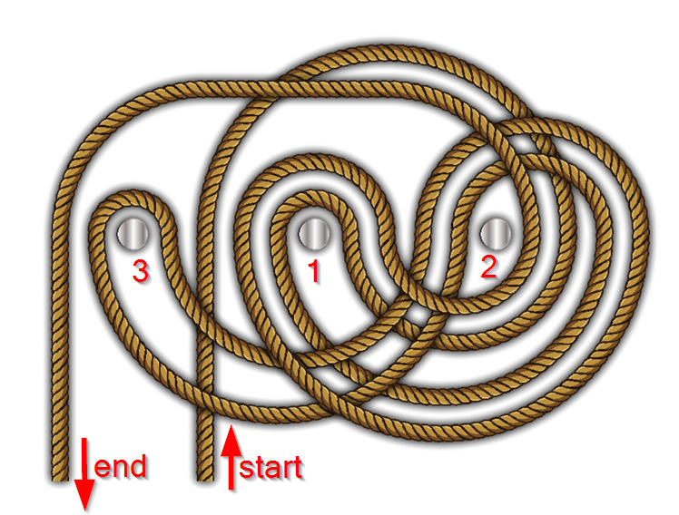

*Picture-hanging solution for three nails problem with the commutator $x_1 x_2 x_1^{-1} x_2^{-1} x_3 x_2 x_1 x_2^{-1} x_1^{-1} x_3^{-1}$*

Commutator contours are the solutions of the problem because removing some nail $i$ algebraically corresponds to removing symbols $x_i$ & $x_i^{-1}$ from the commutator exporession, after which some $x_j, x_j^{-1}$ pairs come "in direct contact" and by step by step multiplication annihilate into $1$, which is interpreted as "the knot is no more".

## Integral representation of special functions
As mentioned, Camille Jordan was the first to introduce the concept of commutator contour in his legendary Cours d'Analyse [[1]](#1) as a tool for constructing integral representation of multivalued complex functions. As seen from the Appendix, he used similar formalism using expressions as $A B A^{-1} B^{-1}$. My first contact with the topic was by being intrigued by the contour in NIST Handbook of special functions [[5]](#5) used in integral representation of Kummer hypergeometric function.

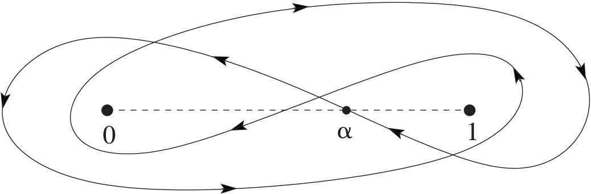

*NIST Handbook of special functions, 13.4, [https://dlmf.nist.gov/13.4](https://dlmf.nist.gov/13.4)*

The handbook also contains the presentation of Jordan-Pochhammer contour used in integral representation of Beta function. Leo Pochhammer visualized it for the first time in "Zur Theorie der Euler'schen Integrale" [[6]](#6) in 1890 in a bit different manner as presented in the Appendix.

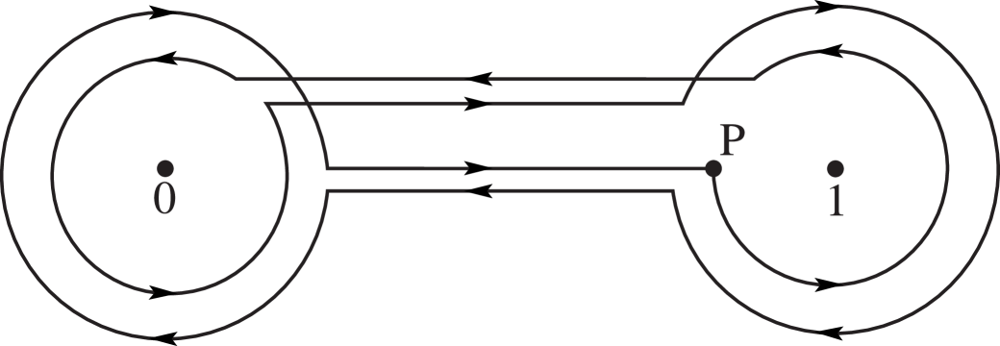

*NIST Handbook of special functions, 5.12, [https://dlmf.nist.gov/5.12](https://dlmf.nist.gov/5.12)*

TODO: I will here skip the theory of integral representations, which I would very much like to cover due to its elegance and beauty: why commutator contour, topology of Riemann surface, traveling the surface and "collecting" the phase, etc...

Related tehnique is used in for integral representations of Legendre functions. With varying number of poles and their configuration there are more than a few cases to cover. One example from, again legendary, Courant-Hilbert Methods of Mathematical Physics, Vol. 1 [[8]](#8), with the full page available in the Appendix:

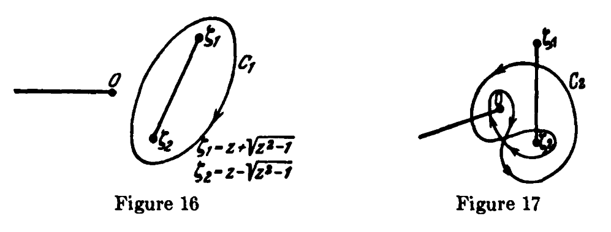

At this point it is interesting to note n-point solutions are not unique. Commutators can be defined in different ways by chosing the symbols we start with. In 2-point example we constructed the commutator with $[x_1, x_2]$. There is another way to do it and that is $[x_1, x_2^{-1}]$, this approach is as valid as any other. This way we get the second solution. Depending on the literature, some use first, some second. Results are the same as the only property we are interested in is commutator contour, any.

Both solutions example for picture-hanging problem:

 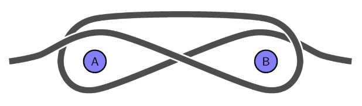

*Two complementary solutions of two nails picture hanging problem from two different sources: [[3]](#3) with commutator $x_1 x_2 x_1^{-1} x_2^{-1}$ and [[7]](#7) with $x_1 x_2^{-1} x_1^{-1} x_2$.*

TODO: Identify commutator contours for integral representations of multivalued functions with 3 or more poles.

A year ago I accidentaly encountered on a small gem, a modest scan of the page of Schrodinger's legendary notebook containing the first record of his equation. The notebook was created during his visit to Villa Herwig-Arosa at Christmas 1925. Along with the equation, this exact part of the page contains a 2-pole integration commutator contour, maybe even with a try to draw a complementary contour as there are two of them with slight experimentation on its construction.

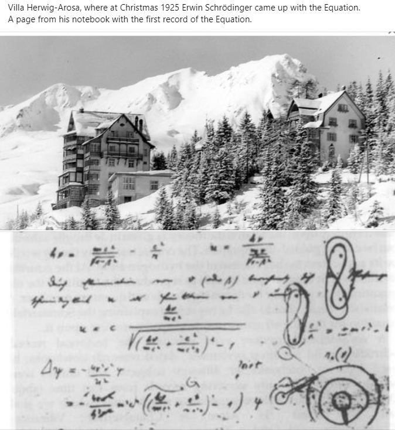

*Note from Schrodinger's 1925 notebook with the first record of the equation. Same part of the page contains two commutator contours, complemetary solutions of the same 2-pole problem. (Disclamer: unverified)*

## Conclusion
I would be interested in obtaining more examples of application of commutator contours, e.g. 3 or 4 or more poles integral representations or in a totaly different domain, and if there has been any generalized treatise to date.

## Appendix

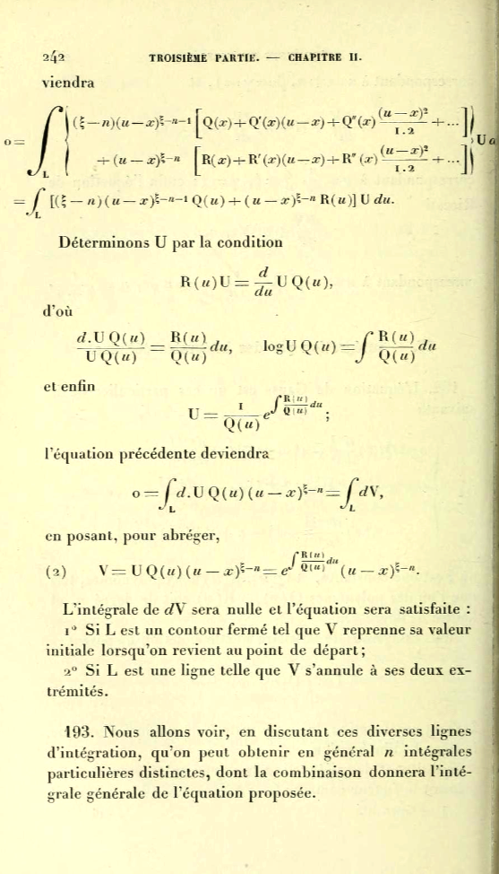

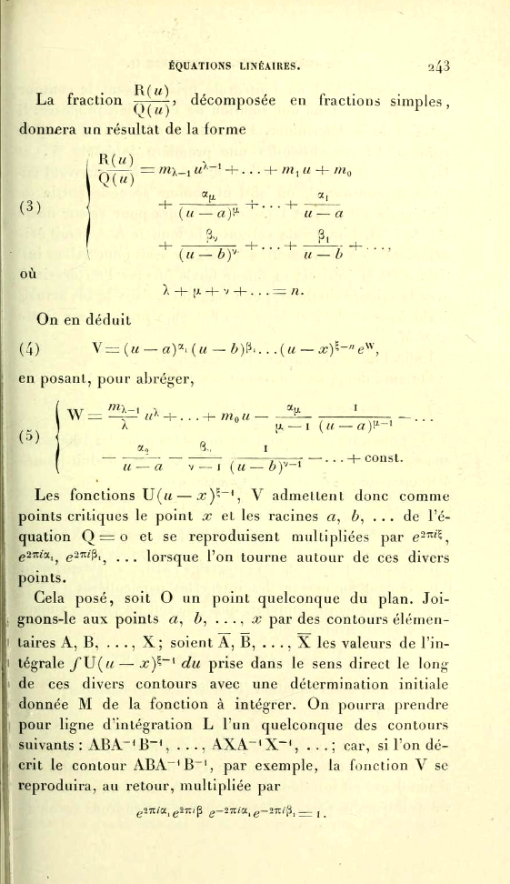

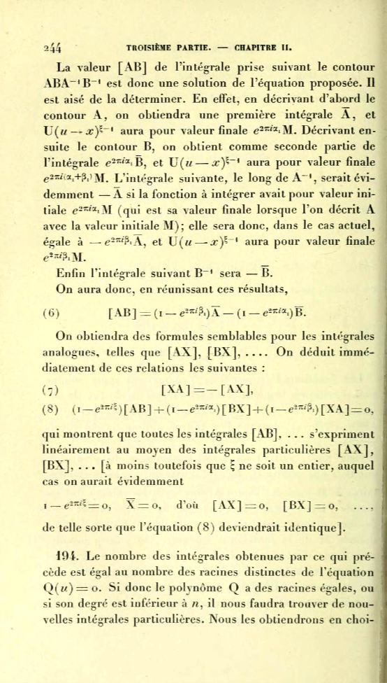

*First introduction of the concept of commutator contour by Camille Jordan, Cours d'Analyse, 1887, Ed. 1, Vol. 3, pg. 242-244, [https://archive.org/details/coursdanalysede08jordgoog/page/242/mode/2up](https://archive.org/details/coursdanalysede08jordgoog/page/242/mode/2up)*

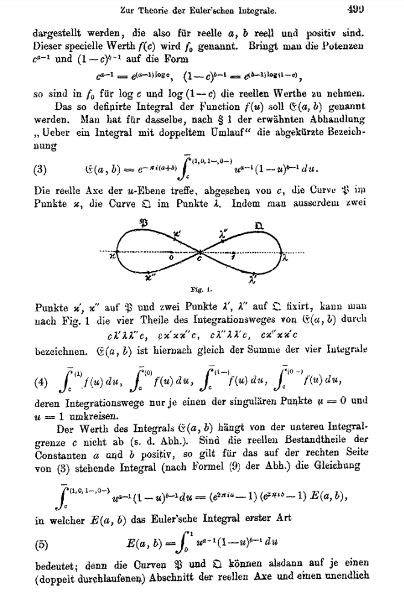

*Pochhammer's first visualization of commutator contour in "Zur Theorie der Euler'schen Integrale", 1890*

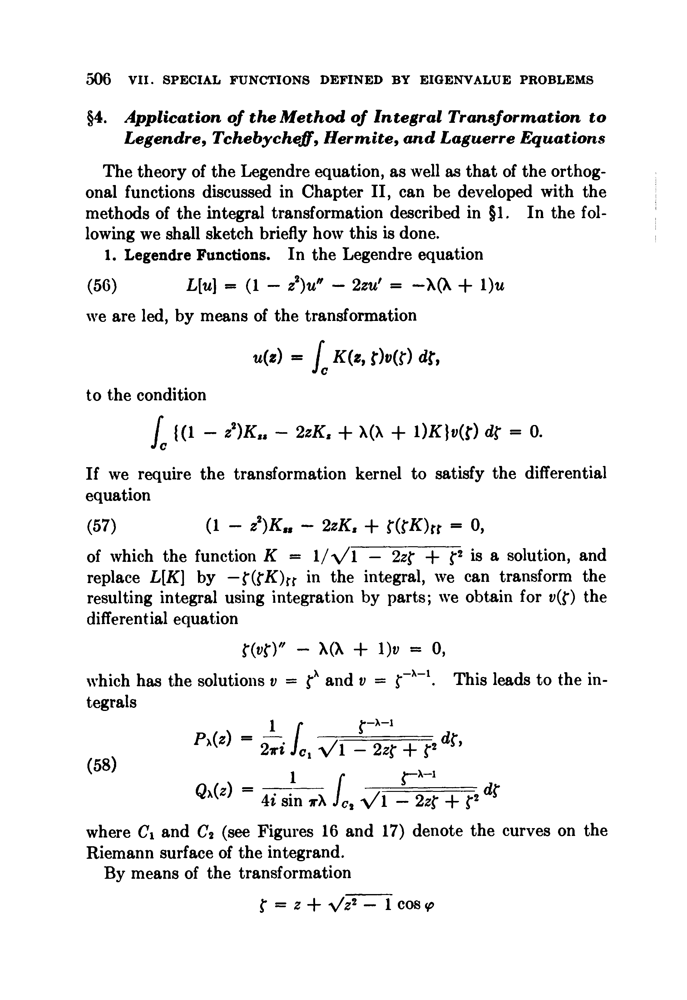

*Integral representation of Legendre function, Courant, Hilbert, Methods of Mathematical Physics [[8]](#8)*

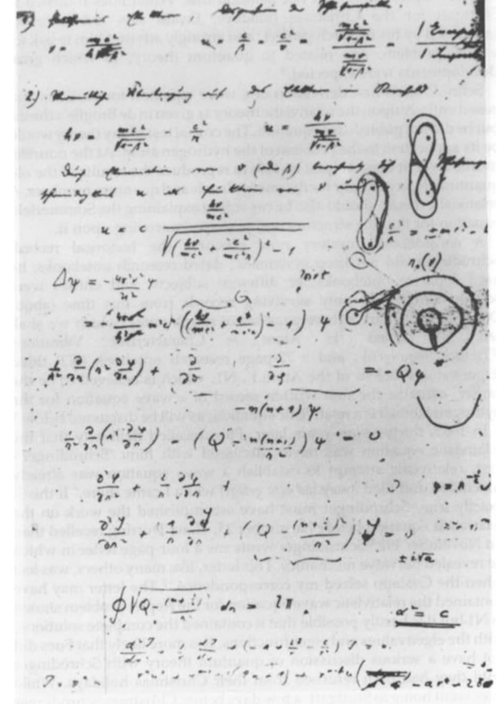

*The page from Schrodinger's 1925 notebook with the first record of the equation. Same part of the page contains two commutator contours of the 2-pole problem. (Disclamer: unverified)*

## References
<a id="1">[1]</a>
Camille Jordan, Cours d'analyse de l'École polytechnique, 1887, Vol. 3, pg. 242-244 [https://archive.org/details/coursdanalysede08jordgoog/page/242/mode/2up](https://archive.org/details/coursdanalysede08jordgoog/page/242/mode/2up)

<a id="2">[2]</a>
[https://en.wikipedia.org/wiki/Pochhammer_contour](https://en.wikipedia.org/wiki/Pochhammer_contour) Jordan-Pochhammer contour

<a id="3">[3]</a>
[https://arxiv.org/abs/1203.3602](https://arxiv.org/abs/1203.3602) Picture-hanging puzzles

<a id="4">[4]</a>
[http://www.mathpuzzle.com/hangingpicture.htm](http://www.mathpuzzle.com/hangingpicture.htm) Ed Pegg Jr., Picture hanging, 2002

<a id="5">[5]</a>
[https://dlmf.nist.gov/13.4](https://dlmf.nist.gov/13.4) Integral representation of Kummer function

<a id="6">[6]</a>
[https://zenodo.org/records/1428390](https://zenodo.org/records/1428390) Pochhammer, L. (1890), Zur Theorie der Euler'schen Integrale, Mathematische Annalen, 35 (4), pg. 499

<a id="7">[7]</a>
[https://laurentlessard.com/bookproofs/hanging-a-picture-frame/](https://laurentlessard.com/bookproofs/hanging-a-picture-frame/)

<a id="8">[8]</a>
R. Courant, D. Hilbert, Methods of Mathematical Physics, Vol. 1, Interscience (Wiley) New York, 1962.
