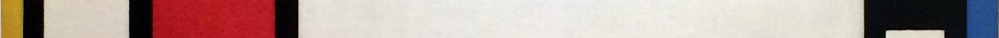

---
output:
  tufte::tufte_html
---

```{r setup, include=FALSE}
knitr::opts_chunk$set(echo = FALSE)
```

<div></div>
<div style="width:100%;margin-bottom:8%;"></div>

<table class="striped">
<tbody>
  <tr>
   <td style="text-align:center;"> 12.06.2020. </td>
   <td style="text-align:left;"> [Demo](https://ahrvoje.github.io/posts/test.html) </td>
   <td style="text-align:right;"> 6 </td>
  </tr>
  <tr>
   <td style="text-align:center;"> 12.06.2020. </td>
   <td style="text-align:left;"> [Demo dependency free](https://ahrvoje.github.io/posts/test_free.html) </td>
   <td style="text-align:right;"> 6 </td>
  </tr>
</tbody>
</table>

```{r}
library(knitr)
library(kableExtra)
dt <- mtcars[1:5, 1:4]

# HTML table
kable_styling(
  kable(dt, format = "html"),
  bootstrap_options = "hover",
  full_width = F
)
```
