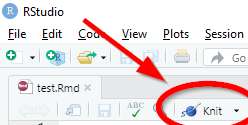

```{r setup, include=FALSE}
knitr::opts_chunk$set(echo = FALSE)
```

# R Markdown

This is an R Markdown document. Markdown is a simple formatting syntax for authoring HTML, PDF^[PDF 2.0 specification [https://www.iso.org/standard/63534.html]], and MS Word documents. For more details on using R Markdown see <http://rmarkdown.rstudio.com>.

\begin{equation}
x^2 + y^2 = z^2 \tag{1} \label{eq:a}
\end{equation}

Inline test $\phi^2 = 1$, and ref to eq. (\\ref{eq:a}).

<table>
<thead>
<tr>
<th>$\alpha$</th>
<th>$\beta^2$</th>
<th>$\sqrt{\delta}$</th>
<th>$\int x^2 = \frac{x^3}{3}$</th>
</tr>
</thead>
<tbody>
<tr>
<td>cell1_1</td>
<td>cell2_1</td>
<td>cell3_1</td>
<td>cell4_1</td>
</tr>
<tr>
<td>cell1_2</td>
<td>cell2_2</td>
<td>cell3_2</td>
<td>cell4_2</td>
</tr>
<tr>
<td>cell1_3</td>
<td>cell2_3</td>
<td>cell3_3</td>
<td>cell4_3</td>
</tr>
<tr>
<td>cell1_4</td>
<td>cell2_4</td>
<td>cell3_4</td>
<td>cell4_4</td>
</tr>
</tbody>
</table>

```{r fig-margin, fig.margin=TRUE, out.width='auto'}

```

When you click the **Knit** button^[Knit button] a document will be generated that includes both content as well as the output of any embedded R code chunks within the document. You can embed an R code chunk like this:

Example of some Python code <code class="language-python">import os</code> using Prism highlighter:

<pre class="language-python line-numbers" style="max-height:30em;">
<code>def QuarterDates(quarter):

    Qstart = [2454953.5,2454964.5,2454998.5]
    Qstop  = [2454962.5,2454997.5,2455100.5]
    if (quarter < len(Qstart)):
        return Qstart[quarter] - 10, Qstop[quarter] + 10
    else:
        message  = 'No spacecraft roll dates recorded for quarter ' + str(quarter) + '.\n'
        message += 'Find an updated script at http://keplergo.arc.nasa.gov'
        sys.exit(message)

def GetMetaData(invid,quarter):

# get start and stop dates for quarter

    Qstart, Qstop = QuarterDates(quarter)

# URL for MAST data access

    url = 'http://archive.stsci.edu/kepler/data_search/search.php?'
    url += 'action=Search'
    url += '&max_records=100000'
    url += '&verb=3'
    url += '&ktc_investigation_id=' + invid
    url += '&ktc_target_type[]=LC'
    url += '&ktc_target_type[]=SC'
    url += '&outputformat=CSV'

# retrieve results from MAST

    lines = urllib.urlopen(url)

# extract metadata from CSV

    print '\n%4s %9s %7s %5s %2s %10s %10s %10s' % \
        ('#', 'KepID', 'InvID', 'KpMag', 'Md', 'Start', 'Stop', 'Release')
    kepid = []; invid = []; mode = []
    ra = []; dec = []; kepmag = []
    start = []; stop = []; release = []
    for line in lines:
        line = line.strip().split(',')
        if (len(line[0]) > 0 and 
            'Kepler' not in line[0] and 
            'integer' not in line[0] and
            'no rows found' not in line[0]):
            GregStart = line[7][:10].split('-')
            GregStop = line[8][:10].split('-')
            JDstart = Greg2JD(int(GregStart[0]),int(GregStart[1]),int(GregStart[2]))
            JDstop = Greg2JD(int(GregStop[0]),int(GregStop[1]),int(GregStop[2]))
            if (JDstart > Qstart and JDstop < Qstop):
                kepid.append(line[0])
                invid.append(line[1])
                kepmag.append(float(line[22]))
                mode.append(line[6])
                ra.append(line[4])
                dec.append(line[5])
                start.append(line[7])
                stop.append(line[8])
                release.append(line[9])
                print '%4d %9s %7s %5.2f %2s %10s %10s %10s' % \
                    (len(kepid), kepid[-1], invid[-1], kepmag[-1], mode[-1], 
                     start[-1][:10], stop[-1][:10], release[-1][:10])
    if (len(kepid) == 0):
        print '\nNo data available as of ' + time.asctime(time.localtime())
    else:
        print '\n' + time.asctime(time.localtime())

    return kepid, invid, kepmag, mode, start, stop, release

def usage():

    print ' -------------------------------------------------------------------------'
    print ' Martin Still (martin.d.still@nasa.gov) NASA Ames Nov 11, 2009'
    print ' '
    print ' Find all quarter data associated with an investigation ID within the MAST'
    print ' archive.'
    print ' '
    print ' Typical usage:'
    print ' KepInvestigationAtMAST.py --invid=GO10003 --quarter=1'
    print ' '
    print ' --invid  Investigation ID number of GO program'
    print ' --quarter  Kepler quarter (integer number)'
    print ' -------------------------------------------------------------------------'
    sys.exit(' ')

#-------------------------------
if __name__ == "__main__":
    main()
</code></pre>

# Including Plots

TikZ example on the right.

```{tikz, fig.ext = 'svg', fig.width=2, fig.margin=TRUE, fig.cap = "Process diagram"}
\usetikzlibrary{arrows, decorations.markings, matrix, bayesnet}

\begin{tikzpicture}
% Define nodes
 \node[obs] (y) {$y_i$};
 \node[latent, above right=of y] (de) {$\delta_i$};
 \node[latent, above left=of y] (v) {$v_i^2$};
 \node[latent, above right=of de] (d) {$d$};
 \node[latent, above left=of de] (t) {$\tau^2$};
 \node[latent, above=of t] (s) {$\sigma^2$};

% Connect the nodes
 \edge {de,v} {y} ;
 \edge {d,t} {de};%
 \draw[double,double equal sign distance,-implies] (s) -- (t);

% Plates
 \plate {pl} {(y)(de)(v)} {$i=1\dots k$} ;
\end{tikzpicture}
```

Note that the `echo = FALSE` parameter was added to the code chunk to prevent printing of the R code that generated the plot.

<a href="garden.jpg"></a>


